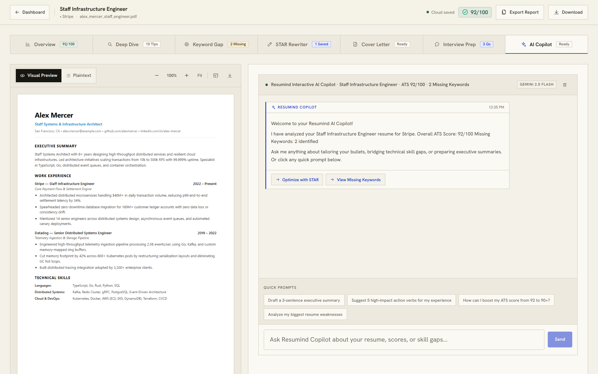
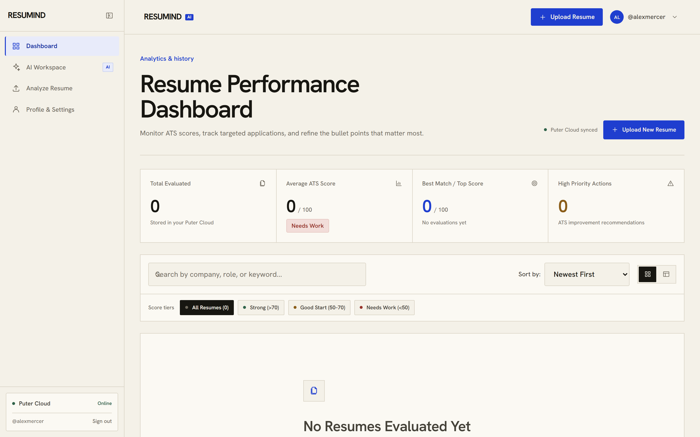
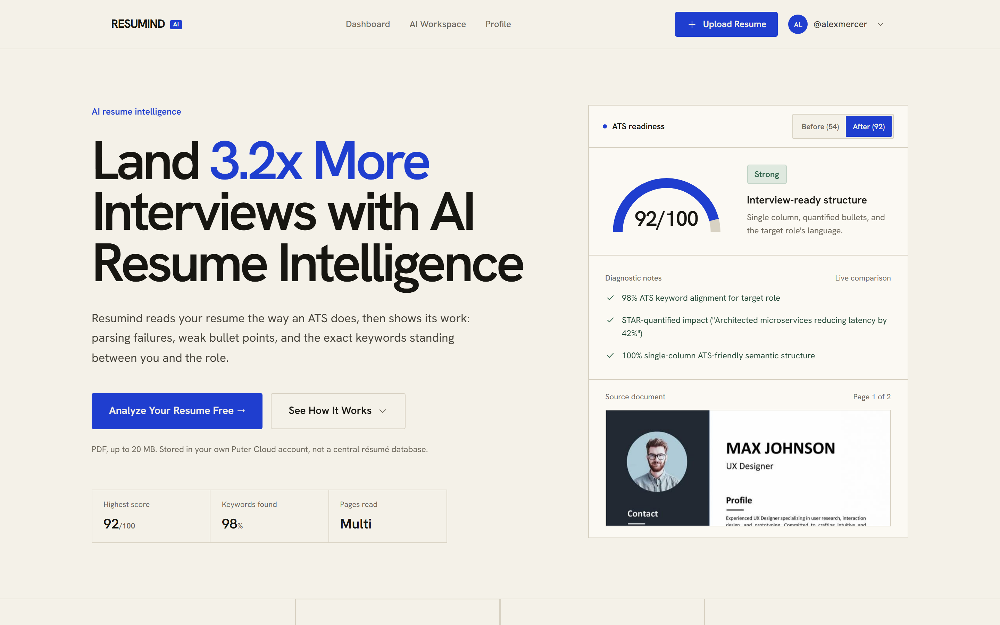
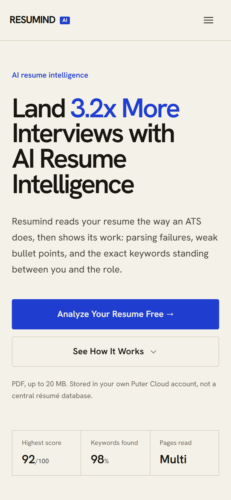
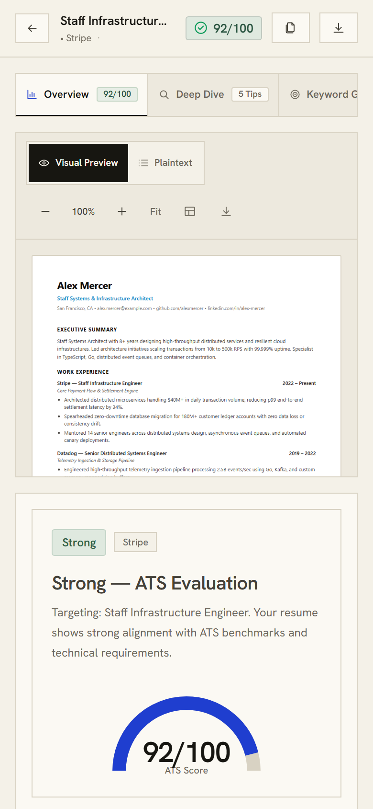
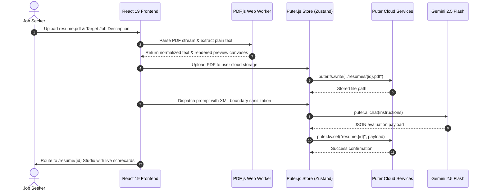

<div align="center">

# 📄 Resumind

### **Commercial-Grade, Privacy-First AI Resume Intelligence & Career Studio**

*Transform your resume into a top-tier candidate profile with multi-dimensional ATS diagnostic scoring, automated STAR bullet rewriting, keyword gap targeting, and personalized interview preparation.*

<br />

[](https://resumind-cv.vercel.app/)
[](https://github.com/Realadityapathak/Resumind-Ai/stargazers)

<br />

[](https://www.typescriptlang.org/)
[](https://react.dev/)
[](https://reactrouter.com/)
[](https://tailwindcss.com/)
[](https://vitest.dev/)
[](https://eslint.org/)
[](https://nodejs.org/)
[](#privacy--security-model)

<br />

```
[ 🚀 Launch Live App ](https://resumind-cv.vercel.app/)  •  [ 📖 Architecture Guide ](docs/ARCHITECTURE.md)  •  [ 🐛 Report Bug ](https://github.com/Realadityapathak/Resumind-Ai/issues)  •  [ 💡 Request Feature ](https://github.com/Realadityapathak/Resumind-Ai/issues)
```

<br />

### 🖥️ Dual-Pane Career Studio Workspace
*High-fidelity PDF document rendering alongside real-time ATS diagnostic scoring and action cards.*


</div>

---

## 📑 Table of Contents

- [Overview & Value Proposition](#-overview--value-proposition)
  - [The Challenge](#the-challenge)
  - [The Resumind Solution](#the-resumind-solution)
- [Core Feature Suite](#-core-feature-suite)
  - [1. Multi-Dimensional ATS Scoring](#1-multi-dimensional-ats-scoring)
  - [2. Intelligent Keyword Gap Matrix](#2-intelligent-keyword-gap-matrix)
  - [3. STAR Method Accomplishment Rewriter](#3-star-method-accomplishment-rewriter)
  - [4. Role-Tailored Cover Letter Architect](#4-role-tailored-cover-letter-architect)
  - [5. 8-Question Interview Preparation Pack](#5-8-question-interview-preparation-pack)
  - [6. Resumind AI Copilot Advisor](#6-resumind-ai-copilot-advisor)
  - [7. Executive Analytics Dashboard](#7-executive-analytics-dashboard)
- [Visual Gallery](#-visual-gallery)
  - [Desktop Experience (1440x900)](#desktop-experience-1440x900)
  - [Mobile Responsive Experience (390x844)](#mobile-responsive-experience-390x844)
- [Privacy & Security Model](#-privacy--security-model)
- [Technical Architecture](#-technical-architecture)
  - [System Flow Diagram](#system-flow-diagram)
  - [Module & Directory Map](#module--directory-map)
- [Tech Stack & Dependencies](#-tech-stack--dependencies)
- [Getting Started](#-getting-started)
  - [Prerequisites](#prerequisites)
  - [Installation & Quick Start](#installation--quick-start)
  - [NPM Scripts Command Center](#npm-scripts-command-center)
  - [Environment Configuration](#environment-configuration)
- [Containerization & Docker Deployment](#-containerization--docker-deployment)
- [Quality Assurance & Testing](#-quality-assurance--testing)
- [Engineering Roadmap](#-engineering-roadmap)
- [Contributing](#-contributing)
- [Acknowledgements](#-acknowledgements)

---

## 🌟 Overview & Value Proposition

### The Challenge
Modern Applicant Tracking Systems (ATS) like Workday, Taleo, Greenhouse, and Lever filter out over **75% of qualified applicants** before human recruiters ever inspect a submission. Job candidates suffer from:

1. **Unforgiving Parsing Disasters:** Multi-column layouts, non-standard section headers, and unreadable graphics cause ATS engines to drop entire job histories.
2. **Invisible Keyword Thresholds:** Automated algorithms drop resumes failing exact-match token thresholds for domain competencies.
3. **Passive Phrasing & Vague Impact:** Bullet points describing task responsibilities rather than quantified business results.
4. **Tool Fatigue & Data Privacy Fears:** Job seekers are forced to upload personal contact info, phone numbers, and career histories to untrusted third-party databases.

### The Resumind Solution

| Traditional Resume Scanners | Resumind AI Career Studio |
|---|---|
| ❌ Stores your personal resume data on centralized third-party servers | ✅ **100% Client-Side Sandboxed:** Resumes live strictly inside your personal Puter account |
| ❌ Surface-level keyword density counting | ✅ **Context-Aware Semantic Matching:** Distinguishes technical vs. domain tools with placement advice |
| ❌ Generic rewrite suggestions ("Make it punchy") | ✅ **Empirical STAR Method Engine:** Action, Metric, and Leadership variants with SITUATION/TASK/ACTION/RESULT breakdowns |
| ❌ Single static score with zero actionable guidance | ✅ **5-Pillar Holistic Audit:** Separate diagnostic scoring for Tone, Content, Structure, Skills, and ATS Parsability |
| ❌ Generic cover letter templates | ✅ **Live Synchronized Assets:** Cover letters and interview prep packs tailored directly from extracted resume achievements |

---

## ⚡ Core Feature Suite

### 1. Multi-Dimensional ATS Scoring
*Instant holistic diagnostic analysis powered by `google/gemini-2.5-flash`.*

Resumind evaluates resumes on a 0–100 scale, displaying an interactive SVG arc gauge alongside tiered quality badges:
- **Tone & Style (0–100):** Scans for strong active verbs, authoritative phrasing, and elimination of pronoun fluff.
- **Content & Impact (0–100):** Identifies quantified financial impact, scale metrics, latency improvements, and percentage efficiencies.
- **Structure & Layout (0–100):** Validates single-column ATS parsability, logical visual hierarchy, and date consistency.
- **Core Skills & Tech (0–100):** Benchmarks target role skills against current industry standards.
- **ATS Parsability (0–100):** Verifies standard section header parsing, standard fonts, and machine readability.


---

### 2. Intelligent Keyword Gap Matrix
*Close the gap between your resume and automated applicant filters.*

- **Punctuation-Aware Regex Tokenizer:** Accurately recognizes nuanced technical tokens containing symbols like `C++`, `C#`, `.NET`, `Go`, `AI`, and `ML` without regex boundary clipping.
- **Categorized Inventory:** Groups target keywords into **Critical**, **Recommended**, and **Optional** tiers across Technical, Domain, and Tooling dimensions.
- **Contextual Suggestions:** Tells you exactly which section of your resume to insert missing competencies.


---

### 3. STAR Method Accomplishment Rewriter
*Transform passive duty descriptions into high-leverage accomplishments.*

Select any bullet point from your resume to generate three battle-tested variants:
- **Action-Oriented:** Emphasizes technical initiative, assertive leadership, and aggressive execution verbs.
- **Metric-Driven:** Maximizes numerical ROI, percentage gains, throughput multipliers, and cost reductions.
- **Leadership-Focused:** Highlights cross-functional team orchestration, technical mentorship, and organizational force multiplication.

Every variant includes an educational breakdown dissecting the **Situation**, **Task**, **Action**, and **Result**.


---

### 4. Role-Tailored Cover Letter Architect
*Generate compelling, job-matched narrative letters in seconds.*

- Dynamically incorporates company culture, job requirements, and your strongest verified resume accomplishments.
- **Instant Tone Toggling:** Switch seamlessly between **Confident**, **Conversational**, **Technical**, and **Formal** registers.
- **Zero-Friction Export:** Edit live in the workspace, inspect in paper preview mode, or download as `.txt` / copy to clipboard.


---

### 5. 8-Question Interview Preparation Pack
*Walk into screening rounds and technical deep-dives fully prepared.*

- Generates 8 custom interview questions mapped directly to potential red flags, major achievements, and technical requirements in your resume.
- Categorized across **Technical Architecture**, **System Scaling**, and **Behavioral Leadership**.
- Includes suggested **Talking Points**, tailored **STAR Framework Answers**, bookmarking, and a live practice scratchpad with autosave.


---

### 6. Resumind AI Copilot Advisor
*An interactive career coach embedded directly in your document studio.*

- **Zero-XSS Markdown Engine:** Formats bold text, bullet lists, blockquotes, code blocks, and headings cleanly without `dangerouslySetInnerHTML`.
- **Context-Aware Recommendations:** Automatically extracts resume weaknesses and surfaces quick action chips (e.g. *"Rewrite bullet with leadership focus"*, *"Inspect missing keywords"*).
- **Synchronous History Preservation:** Guarantees that multi-turn conversational advice persists reliably to cloud storage.



---

### 7. Executive Analytics Dashboard
*Comprehensive command center for your career pipeline.*

- **KPI Metric Stat Cards:** Live metrics calculating Average ATS Score, Total Evaluated Resumes, Top Strength Pillar, and Active Priority Action Items.
- **Instant Multi-Column Search:** Live filtering across company names, target roles, filenames, and extracted ATS advice.
- **Score-Tier Chips:** One-click filtering by Strong (80+), Good Start (60–79), and Needs Work (<60).
- **Dual Visual Modes:** Toggle smoothly between a responsive Card Grid and an executive Table View.
- **Accessible Deletion:** Complete WCAG 2.1 AA keyboard accessible deletion dialog with focus containment and `Escape` key dismissal.



---

## 📸 Visual Gallery

### Desktop Experience (1440x900)

| View | Screenshot | Key Highlights |
|---|---|---|
| **Landing Hero** |  | Warm paper & ink design language, clear value proposition, and instant sign-in. |
| **Interactive Showcase** |  | Interactive Score Gauge toggle previewing Before (54) and After (92) ATS scores. |
| **Puter Cloud Auth** |  | Zero-trust authentication modal connecting your personal Puter cloud environment. |
| **Upload Pipeline** |  | Drag-and-drop PDF uploader with multi-page text extraction and 10-page OOM protection. |
| **Workspace Studio** |  | Dual-pane studio: Left PDF previewer with text switch + Right scoring summary. |
| **Career Profile** |  | Candidate target role, industry, years of experience, and evaluation strictness settings. |

### Mobile Responsive Experience (390x844)

| Mobile Landing | Mobile Workspace Studio | Mobile Dashboard |
|---|---|---|
|  |  |  |

---

## 🔒 Privacy & Security Model

Resumind is engineered around a **zero-trust, zero-central-database privacy architecture**:

```
+----------------------------------------------------------------------------------------+
|                                    YOUR BROWSER                                        |
|                                                                                        |
|  [PDF Upload] ──► [Local PDF.js Extraction] ──► [XML Escaping & Prompt Guardrails]     |
|                                                                                        |
|  [PII-Safe Telemetry] ──► Strips SSNs, Credit Cards, Emails & Phone Numbers            |
|  [Content Security Policy] ──► Strict allowlist restricting external execution         |
+-------------------------------------------+--------------------------------------------+
                                            │ Direct Client SDK
                                            ▼
+----------------------------------------------------------------------------------------+
|                                  PUTER CLOUD PLATFORM                                  |
|                                                                                        |
|  • File Storage (fs): Encrypted document storage in user-owned sandboxed container     |
|  • Key-Value Store (kv): Private evaluations stored under user account credentials     |
|  • AI Model Bridge: Ephemeral prompt execution via Google Gemini Flash                 |
+----------------------------------------------------------------------------------------+
```

1. **Zero Central Database:** The repository maintains no backend PostgreSQL, MongoDB, or MySQL server storing your personal data.
2. **Puter Cloud Sandboxing:** Resumes and preview images reside strictly in your authenticated personal Puter storage.
3. **Automated PII Telemetry Masking:** Custom telemetry filters automatically scrub Social Security Numbers, credit cards, emails, phone numbers, and raw candidate resume bodies before logs are recorded.
4. **Prompt Injection Immunization:** User inputs are wrapped in strict XML tags (`<job_title>`, `<job_description>`) with automated delimiter escaping (`sanitizeXmlBoundary`) to defeat prompt override attempts.
5. **Strict Content Security Policy (CSP):** Restricted origin policies safeguard against unauthorized script execution and cross-site scripting (XSS).

---

## 🏗️ Technical Architecture

For an in-depth architectural guide covering Puter.js lifecycle state machines, PDF rendering pipelines, and fault-tolerant KV deserialization, see [**`docs/ARCHITECTURE.md`**](docs/ARCHITECTURE.md).

### System Flow Diagram



### Module & Directory Map

```text
AI-Resume-Analyzer/
├── app/
│   ├── components/            # Shared, reusable UI & layout components
│   │   ├── auth/              # AuthGuard session protection wrapper
│   │   ├── layout/            # Responsive Navbar, desktop-deduplicated Sidebar
│   │   └── ui/                # Accordion, ScoreGauge, Icon, MarkdownMessage
│   ├── features/              # Self-contained modular business domains
│   │   ├── copilot/           # AI Copilot engine, chat interface, and prompts
│   │   ├── cover-letter/      # Tailored cover letter generator & text export
│   │   ├── interview-prep/    # Behavioral & technical question generator
│   │   ├── keyword-gap/       # Punctuation-aware regex matcher & gap matrix
│   │   ├── resume-analysis/   # 5-Pillar evaluation prompts & strictness logic
│   │   ├── resume-workspace/  # Dual-pane PDF previewer & overview tab suites
│   │   ├── star-rewriter/     # STAR bullet points rewriter engine
│   │   └── upload/            # FileUploader, dropzone, and upload pipeline
│   ├── hooks/                 # Custom React hooks (useSafeTimeout, useScrollReveal)
│   ├── routes/                # Application routes (home, auth, dashboard, workspace, profile, wipe)
│   ├── services/              # External service integrations (Puter store, PDF engine, Telemetry)
│   ├── styles/                # Tailwind CSS global design tokens & @media print rules
│   └── utils/                 # Utilities (cleanJson, safeJsonParse, exportReport, uuid)
├── docs/                      # Technical documentation & captured screenshots
│   ├── ARCHITECTURE.md        # Complete system architecture & data flow manual
│   └── screenshots/           # Real high-resolution UI screenshots (16 images)
├── public/                    # Static assets (pdf.worker.min.mjs, favicons, sample images)
├── scripts/                   # Developer utilities (automated screenshot capture pipeline)
├── test/                      # Comprehensive testing suite (50 files, 640 tests)
│   ├── components/            # Accessible component tests (focus traps, ARIA)
│   ├── integration/           # End-to-end user journey & security stress tests
│   ├── mocks/                 # High-fidelity in-memory Puter cloud mock harness
│   ├── routes/                # Route composition, cleanup, and wipe tests
│   └── unit/                  # Engine stress tests, prompt injection & PII tests
├── Dockerfile                 # Multi-stage security-hardened Alpine container
├── eslint.config.js           # Modern ESLint flat configuration (TypeScript & React)
├── package.json               # Dependencies, scripts, and runtime engines
├── react-router.config.ts     # React Router v7 framework configuration
├── tsconfig.json              # TypeScript strict compiler options
├── vite.config.ts             # Vite bundler configuration & path aliases
└── vitest.config.ts           # Vitest runner configuration & coverage rules
```

---

## 💻 Tech Stack & Dependencies

| Layer | Technology | Version | Purpose |
|---|---|---|---|
| **Core UI** | [React](https://react.dev/) | `^19.1.0` | Component composition, server-side rendering, and concurrent features |
| **Framework** | [React Router](https://reactrouter.com/) | `^7.18.5` | Framework mode routing, nested routes, and SSR serving pipeline |
| **Styling** | [Tailwind CSS](https://tailwindcss.com/) | `^4.1.4` | Modern CSS v4 utility design system with paper & ink color tokens |
| **State** | [Zustand](https://github.com/pmndrs/zustand) | `^5.0.6` | Reactive, decoupled state management for Puter Cloud synchronization |
| **PDF Engine** | [PDF.js](https://mozilla.github.io/pdf.js/) | `^5.3.93` | Client-side text stream extraction and high-DPI canvas preview rendering |
| **Bundler** | [Vite](https://vitejs.dev/) | `^6.4.6` | Sub-second Hot Module Replacement (HMR) and optimized client bundling |
| **Cloud SDK** | [Puter.js](https://puter.com/) | `v2` | Zero-backend auth, cloud file system, key-value store, and AI gateway |
| **AI Model** | [Gemini 2.5 Flash](https://deepmind.google/technologies/gemini/) | `Latest` | High-speed, structured JSON resume analysis and conversational reasoning |
| **Testing** | [Vitest](https://vitest.dev/) | `^4.1.12` | Lightning-fast test runner with native ESM, JSDOM, and V8 coverage |
| **Test Helpers** | [Testing Library](https://testing-library.com/) | `^16.3.3` | User-centric DOM testing, accessible role queries, and event dispatches |
| **Linter** | [ESLint](https://eslint.org/) | `^10.15.0` | TypeScript and React code quality enforcement with modern flat config |
| **Language** | [TypeScript](https://www.typescriptlang.org/) | `^5.8.3` | Strict type safety across all engines, components, and cloud payloads |

---

## 🚀 Getting Started

### Prerequisites
- **Node.js:** `>= 24.15.0` (LTS recommended)
- **npm:** `>= 10.0.0`
- **Git**

### Installation & Quick Start

1. **Clone the repository:**
   ```bash
   git clone https://github.com/Realadityapathak/AI-Resume-Analyzer.git
   cd AI-Resume-Analyzer
   ```

2. **Install dependencies:**
   ```bash
   npm ci
   ```

3. **Start the local development server:**
   ```bash
   npm run dev
   ```
   Open [**http://localhost:5173**](http://localhost:5173) in your browser.

4. **Build and serve production bundle:**
   ```bash
   npm run build
   npm run start
   ```
   The production SSR server will be listening on [**http://localhost:3000**](http://localhost:3000).

---

### ⌨️ NPM Scripts Command Center

| Command | Purpose |
|---|---|
| `npm run dev` | Starts the Vite development server with Hot Module Replacement on port `5173`. |
| `npm run build` | Builds both the client assets and SSR server bundles for production. |
| `npm run start` | Launches the `@react-router/serve` production server on port `3000`. |
| `npm run typecheck` | Executes `react-router typegen` followed by strict `tsc` compiler checks. |
| `npm run lint` | Runs ESLint 10 across all codebase files with zero tolerated warnings. |
| `npm test` | Runs the full Vitest suite (50 files, 640 tests) in single-run mode. |
| `npm run test:watch` | Starts Vitest in interactive, watch mode for rapid test-driven development. |
| `npm run test:coverage` | Generates a complete V8 line, branch, and function coverage report. |

---

### ⚙️ Environment Configuration

Resumind is pre-configured to run out of the box using Puter's automatic client sandbox. If you wish to configure server ports or bind an official Puter Developer App ID, copy `.env.example`:

```bash
cp .env.example .env
```

```env
# Server Runtime (Used by @react-router/serve and Docker)
PORT=3000
NODE_ENV=development

# Optional: Puter Developer App ID (Obtain at https://puter.com/dashboard)
# Leave blank to operate in standard anonymous sandbox mode.
VITE_PUTER_APP_ID=
```

---

## 🐳 Containerization & Docker Deployment

Resumind includes an enterprise-hardened, multi-stage `Dockerfile` built upon Alpine Linux:

```bash
# Build the production Docker image
docker build -t resumind-app .

# Run the containerized server
docker run -d -p 3000:3000 --name resumind resumind-app
```

### Container Hardening Highlights
- **Layer-Optimized Caching:** Separates `package*.json` caching from source code copies, speeding up rebuilds.
- **Unprivileged Execution:** Operates strictly under `USER node` to prevent root container breakout vectors.
- **Built-in Healthcheck:** Integrated `HEALTHCHECK` command validating HTTP status via `wget --spider` every 30 seconds.
- **Graceful Termination (PID 1):** Bypasses `npm` wrappers to ensure `SIGTERM` and `SIGINT` signals drain connections gracefully.

---

## 🧪 Quality Assurance & Testing

Resumind features an adversarial test suite boasting **640 tests across 50 test files** with **100% pass rate**:

```bash
npm test
```

```text
 ✓ test/components/AICopilotTab.test.tsx (10 tests)
 ✓ test/components/CoverLetterTab.test.tsx (14 tests)
 ✓ test/components/InterviewPrepTab.test.tsx (9 tests)
 ✓ test/components/MarkdownMessage.test.tsx (17 tests)
 ✓ test/components/NavbarVariant.test.tsx (3 tests)
 ✓ test/components/dashboardModalAccessibility.test.tsx (5 tests)
 ✓ test/integration/resumeJourney.integration.test.tsx (1 test)
 ✓ test/integration/resumeJourneySecurity.integration.test.tsx (13 tests)
 ✓ test/routes/dashboard.test.tsx (15 tests)
 ✓ test/routes/wipe.test.tsx (9 tests)
 ✓ test/routes/workspace.test.tsx (10 tests)
 ✓ test/unit/exportReport.test.ts (5 tests)
 ✓ test/unit/prompt.test.ts (7 tests)
 ✓ test/unit/telemetry.test.ts (17 tests)
 ✓ test/unit/useScrollReveal.test.ts (8 tests)
 ... 35 additional test suites

 Test Files  50 passed (50)
      Tests  640 passed (640)
   Duration  32.77s
```

### Tested Quality Domains
- **Adversarial Security:** Neutralization of prototype pollution vectors, prompt injection escapes, XSS payloads, and path traversal attempts.
- **Resilience & Fault Tolerance:** Automatic fallback to offline interview questions during AI outages; KV serialization repair for malformed envelopes.
- **Accessibility:** Automated assertions for WCAG 2.1 AA color contrast compliance, `Escape` key dialog dismissal, and focus trapping.
- **Internationalization:** UTF-8 extraction verification supporting CJK characters, Arabic RTL scripts, and accented Latin glyphs.

---

## 🗺️ Engineering Roadmap

- [x] **Milestone 1:** Authentication, Multi-Page PDF Processing, and 5-Pillar ATS Diagnostic Scoring.
- [x] **Milestone 2:** Executive Analytics Dashboard, KPI Stat Cards, and Atomic Cloud Data Deletion.
- [x] **Milestone 3:** STAR Method Bullet Rewriter and Punctuation-Aware Keyword Gap Matrix.
- [x] **Milestone 4:** Tailored Cover Letter Generator, 8-Question Interview Prep Pack, and AI Copilot.
- [x] **Production Hardening:** Docker security containerization, WCAG 2.1 AA contrast fixes, modal focus traps, and 10-page OOM protection.
- [x] **Product & Developer Polish:** ATS Markdown report export, zero-XSS Markdown tokenizer, PII-scrubbing telemetry, and ESLint flat config.
- [ ] **Upcoming Releases:**
  - [ ] Side-by-side comparison mode for multiple candidate resume versions.
  - [ ] One-click export to LinkedIn profile summary markdown format.
  - [ ] Automatic LaTeX resume template export.
  - [ ] Native dark mode palette toggle.

---

## 🤝 Contributing

We welcome contributions from the engineering community! To contribute:

1. **Fork the repository.**
2. **Create a descriptive feature branch:**
   ```bash
   git checkout -b feat/amazing-enhancement
   ```
3. **Commit your changes using conventional commits:**
   ```bash
   git commit -m "feat: add side-by-side resume comparison mode"
   ```
4. **Verify that all tests and linters pass:**
   ```bash
   npm test && npm run typecheck && npm run lint
   ```
5. **Push to your branch:**
   ```bash
   git push origin feat/amazing-enhancement
   ```
6. **Open a Pull Request with a clear description of your changes.**

---

## 🙏 Acknowledgements

- Built with [React Router](https://reactrouter.com/) and [Tailwind CSS](https://tailwindcss.com/).
- Serverless authentication, cloud storage, and AI reasoning powered by [Puter.js](https://puter.com/).
- PDF text extraction and canvas preview rendering powered by Mozilla's [PDF.js](https://mozilla.github.io/pdf.js/).
- Designed with dedication to leveling the playing field for ambitious job seekers worldwide.

<br />

<div align="center">
  <sub>Built with ❤️ by <a href="https://github.com/Realadityapathak">Aditya Pathak</a> and contributors.</sub>
</div>
