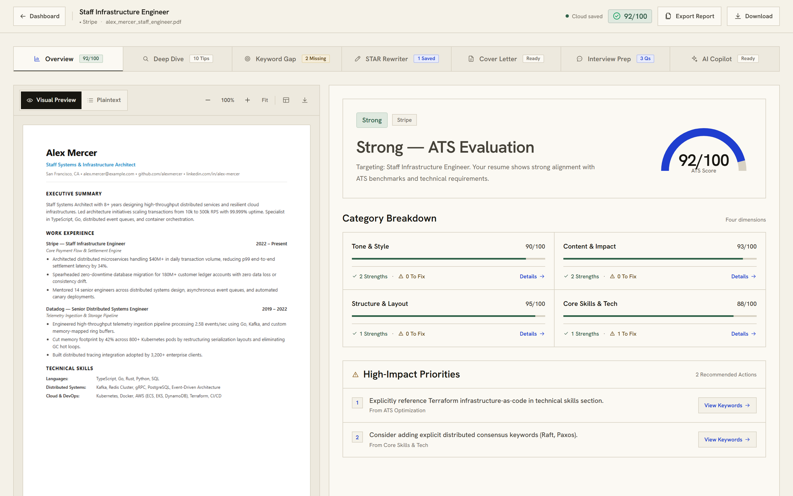
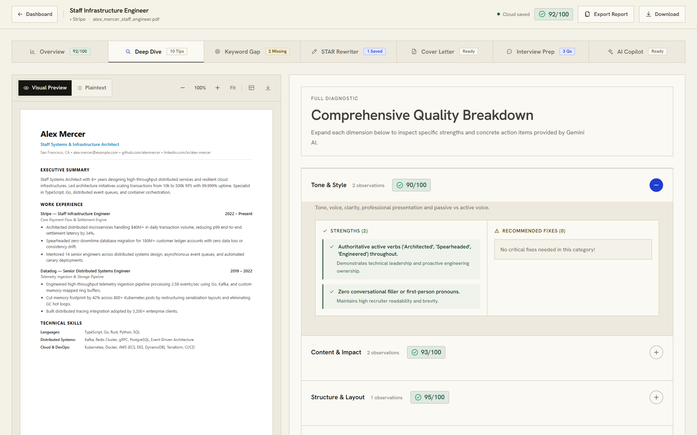
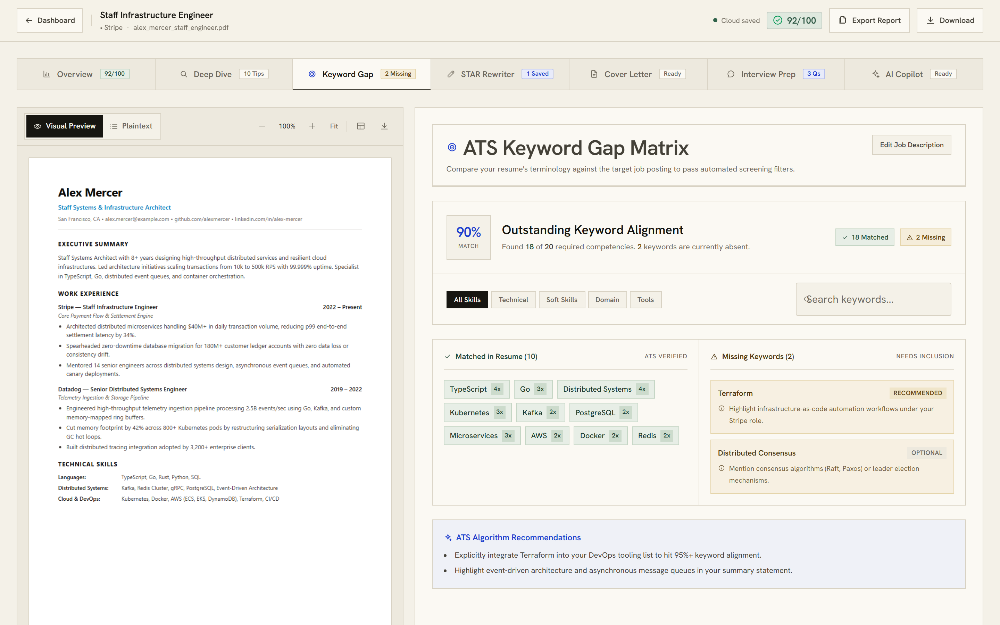
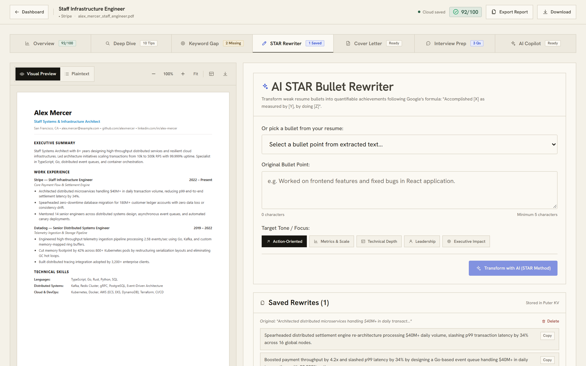
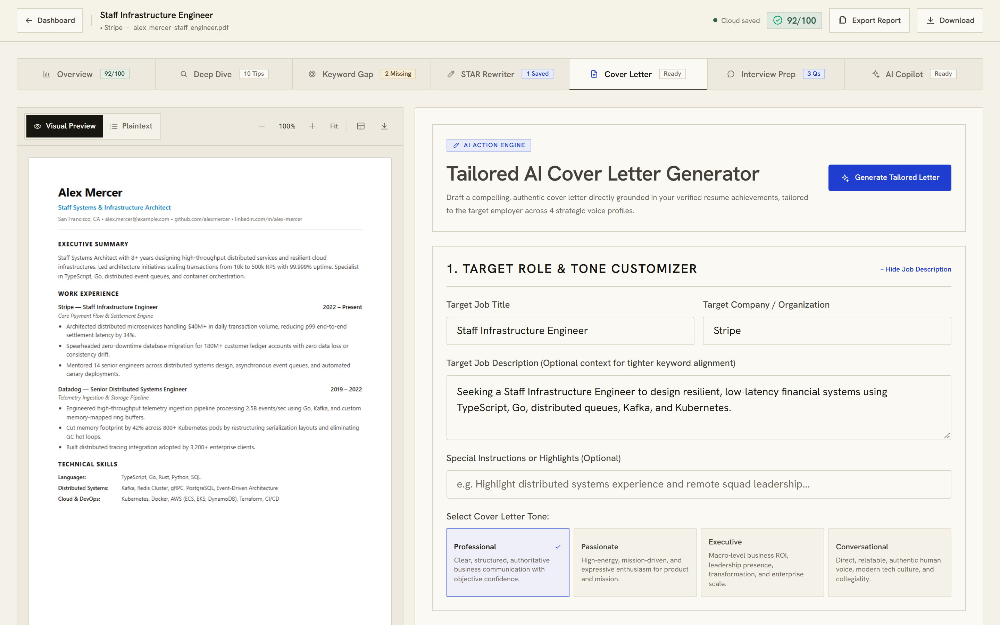
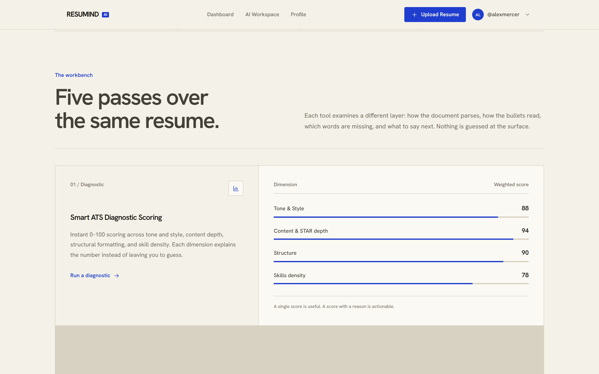
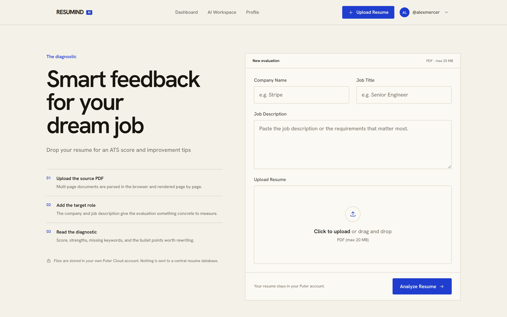
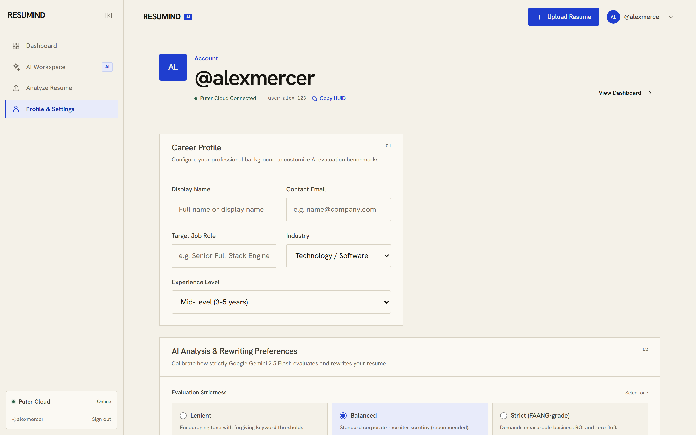
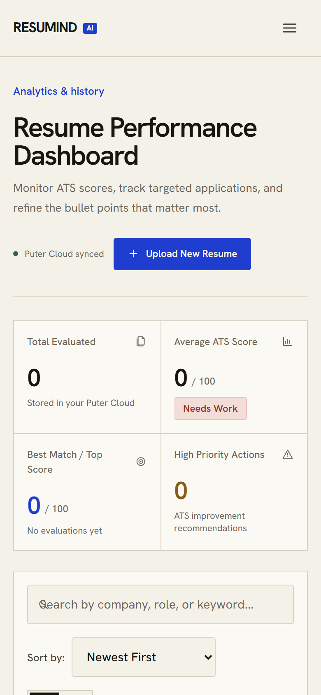

<div align="center">

# Resumind

### Privacy-First AI Resume Analyzer & Comprehensive Career Preparation Suite

Empowering job seekers with instant, multi-dimensional ATS resume evaluations, automated STAR bullet rewriting, keyword gap targeting, and personalized interview preparation.

[](LICENSE)
[](https://www.typescriptlang.org/)
[](https://react.dev/)
[](https://reactrouter.com/)
[](https://tailwindcss.com/)
[](https://vitest.dev/)
[](CONTRIBUTING.md)

<br />



</div>

---

## Table of Contents

- [About Resumind](#about-resumind)
  - [The Problem](#the-problem)
  - [The Solution](#the-solution)
- [Key Features](#key-features)
- [Visual Tour & Gallery](#visual-tour--gallery)
  - [Desktop Experience](#desktop-experience)
  - [Mobile Experience](#mobile-experience)
- [Tech Stack](#tech-stack)
- [Architecture & Folder Structure](#architecture--folder-structure)
  - [Data Flow Architecture](#data-flow-architecture)
  - [Project Tree](#project-tree)
- [Getting Started](#getting-started)
  - [Prerequisites](#prerequisites)
  - [Installation](#installation)
  - [Environment Variables](#environment-variables)
  - [Running Locally](#running-locally)
- [Usage Guide](#usage-guide)
  - [Evaluating a Resume](#evaluating-a-resume)
  - [Exporting Reports](#exporting-reports)
  - [Data Privacy & Management](#data-privacy--management)
- [Testing & Quality Assurance](#testing--quality-assurance)
- [Containerization & Production Deployment](#containerization--production-deployment)
- [Roadmap](#roadmap)
- [Contributing](#contributing)
- [License](#license)
- [Acknowledgements & Support](#acknowledgements--support)

---

## About Resumind

### The Problem
Modern Applicant Tracking Systems (ATS) and talent teams reject over 75% of qualified resumes before a hiring manager ever sees them. Candidates often struggle with:
- **Opaque Parsing Failures:** Invisible ATS formatting bugs, multi-column layout glitches, and unreadable headers.
- **Keyword Mismatches:** Missing role-critical competencies and domain keywords required by automated screeners.
- **Weak Action Phrasing:** Vague job descriptions that lack measurable metrics, technical leadership, and business results.
- **Fragmented Preparation:** Juggling disconnected tools for resume tailoring, cover letters, and interview coaching.

### The Solution
**Resumind** provides an integrated, commercial-grade career workspace. Running directly in modern browsers via client-side Puter.js integration, Resumind evaluates your resume across five distinct quality dimensions, compares it against real job descriptions, and equips you with tailored application assets—all while keeping your documents private and stored securely under your own account.

---

## Key Features

- 🎯 **Multi-Dimensional ATS Scoring:** Instant scoring from 0 to 100 with grade badges (A/B/C/Needs Work) across five pillars: Tone & Style, Content & Impact, Structure & Layout, Core Skills, and ATS Parsability.
  
  

- 🔍 **Interactive Keyword Gap Matrix:** Extracts technical and domain keywords from job descriptions, analyzes frequency vs. resume presence, and categorizes terms by criticality with actionable placement advice.
  
  

- ✨ **Automated STAR Bullet Rewriter:** Converts passive bullet points into high-impact accomplishments using the Situation-Task-Action-Result framework, generating Action-Oriented, Metric-Driven, and Leadership-Focused variants.
  
  

- ✉️ **Tailored Cover Letter Generator:** Crafts customized, professional cover letters matching job requirements, with tone adjustments (Confident, Conversational, Technical, Formal) and one-click plain text export.
  
  

- 🎤 **Targeted Interview Prep Pack:** Synthesizes custom behavioral, technical, and situational interview questions with talking points, STAR response structures, and a persistent practice scratchpad.
  
  

- 💬 **Resumind Career Copilot:** In-app AI career advisor rendering rich Markdown formatting, bold takeaways, code blocks, and context-sensitive action suggestions.
  
  

- 📊 **Unified Personal Dashboard:** Track and organize all past evaluations with real-time KPI metrics, search filtering, score-tier sorting, and batch data wiping.
  
  

- 🛡️ **Privacy-First Architecture:** Your resumes and data remain stored in your authenticated Puter account. Zero external analytics trackers, automated client-side PII scrubbing in telemetry, and strict Content Security Policy.

---

## Visual Tour & Gallery

### Desktop Experience (1440x900)

| View | Preview |
|---|---|
| **Landing Hero**<br />*Clean typography, clear value proposition, and instant sign-in.* |  |
| **Interactive Feature Showcase**<br />*Live interactive score gauge preview and feature highlights.* |  |
| **Authentication Flow**<br />*Instant, seamless login powered by Puter Cloud.* |  |
| **Resume Upload & Parsing**<br />*Drag-and-drop PDF ingestion with live text extraction.* |  |
| **Workspace Overview**<br />*Dual-pane workspace with live PDF viewer and score summary.* |  |
| **Career Profile & Settings**<br />*Custom target roles, target scores, and evaluation strictness.* |  |

### Mobile Experience (390x844)

| Mobile Landing | Mobile Workspace | Mobile Dashboard |
|---|---|---|
|  |  |  |

---

## Tech Stack

### Frontend & Application Layer
- **Framework:** [React 19](https://react.dev/) + [React Router 7](https://reactrouter.com/) (SSR & Client Architecture)
- **Styling:** [Tailwind CSS v4](https://tailwindcss.com/) with custom paper/ink design tokens
- **Icons:** Custom accessible inline SVG icon system
- **State Management:** [Zustand v5](https://github.com/pmndrs/zustand)
- **Document Processing:** [PDF.js v5](https://mozilla.github.io/pdf.js/) (`pdfjs-dist`) with local Web Worker integration
- **Build Tool:** [Vite 6](https://vitejs.dev/) with React Router framework mode

### Backend & Cloud Infrastructure
- **Server Runtime:** Node.js (v24 LTS) with `@react-router/serve`
- **Cloud Platform Services:** [Puter.js v2 SDK](https://puter.com/)
  - **Auth:** Client-side zero-trust authentication
  - **Storage:** Puter FileSystem (`fs`) with atomic upload rollbacks
  - **Persistence:** Puter Key-Value (`kv`) database
  - **AI Engines:** Hosted `google/gemini-2.5-flash` model integration

### Quality & Engineering Tooling
- **Test Runner:** [Vitest v4](https://vitest.dev/) with JSDOM environment
- **Component Testing:** [Testing Library](https://testing-library.com/) (React & User Event)
- **Static Analysis:** [TypeScript 5.8](https://www.typescriptlang.org/) (Strict Mode) & [ESLint 10](https://eslint.org/) (Flat Config)
- **Containerization:** Multi-stage Docker with non-root execution and healthcheck monitoring

---

## Architecture & Folder Structure

### Data Flow Architecture

```
┌────────────────────────────────────────────────────────┐
│                   Browser Client                       │
│  React 19 UI  ◄──►  Zustand Store  ◄──►  PDF.js Worker │
└──────────────────────────┬─────────────────────────────┘
                           │
            Puter.js v2 Client Integration
                           │
      ┌────────────────────┼────────────────────┐
      ▼                    ▼                    ▼
┌──────────────┐     ┌──────────────┐     ┌──────────────┐
│  Puter Auth  │     │ Puter FS/KV  │     │   Puter AI   │
│  User State  │     │  Documents   │     │ Gemini Flash │
└──────────────┘     └──────────────┘     └──────────────┘
```

### Project Tree

```text
AI-Resume-Analyzer/
├── app/
│   ├── components/            # Reusable UI & Layout Components
│   │   ├── auth/              # AuthGuard & route protection
│   │   ├── layout/            # Navbar, Sidebar
│   │   └── ui/                # Accordion, ScoreGauge, Icon, MarkdownMessage
│   ├── features/              # Modular Feature Domains
│   │   ├── copilot/           # AI Copilot engine & chat interface
│   │   ├── cover-letter/      # Cover letter generation & export
│   │   ├── interview-prep/    # Question pack generation & scratchpad
│   │   ├── keyword-gap/       # Keyword matcher & gap matrix
│   │   ├── resume-analysis/   # Prompt templates & ATS analysis engines
│   │   ├── resume-workspace/  # Dual-pane PDF previewer & overview tabs
│   │   ├── star-rewriter/     # STAR bullet points rewriter engine
│   │   └── upload/            # File dropzone & PDF upload pipeline
│   ├── hooks/                 # Custom React hooks (useSafeTimeout, useScrollReveal)
│   ├── routes/                # Application routes (home, auth, dashboard, workspace, upload, profile, wipe)
│   ├── services/              # External services (Puter store, PDF engine, telemetry)
│   ├── styles/                # Tailwind CSS global stylesheet & print media rules
│   └── utils/                 # Utilities (cleanJson, safeJsonParse, exportReport, uuid)
├── docs/                      # Technical documentation & captured screenshots
│   ├── README.md              # In-depth architectural guide
│   └── screenshots/           # Real UI screenshot gallery
├── public/                    # Static assets (pdf.worker.min.mjs, favicons)
├── test/                      # Comprehensive test suites
│   ├── components/            # Component-level tests
│   ├── integration/           # End-to-end journey tests
│   ├── routes/                # Route integration tests
│   └── unit/                  # Engine & utility stress tests
├── Dockerfile                 # Production multi-stage container
├── eslint.config.js           # Modern ESLint flat configuration
├── package.json               # Dependencies and scripts
└── vitest.config.ts           # Vitest configuration & coverage rules
```

---

## Getting Started

### Prerequisites
- **Node.js:** `>= 24.15.0` (LTS recommended)
- **npm:** `>= 10.0.0`
- **Git**

### Installation

1. Clone the repository:
   ```bash
   git clone https://github.com/Realadityapathak/AI-Resume-Analyzer.git
   cd AI-Resume-Analyzer
   ```

2. Install dependencies:
   ```bash
   npm ci
   ```

### Environment Variables

Resumind runs client-side using Puter.js and does not require complex database credentials. Create a `.env` file based on the example:

```bash
cp .env.example .env
```

Configuration parameters:
```env
# Server Runtime
PORT=3000
NODE_ENV=development

# Optional: Custom Puter Developer App ID
VITE_PUTER_APP_ID=
```

### Running Locally

- **Development Mode (with Hot Module Replacement):**
  ```bash
  npm run dev
  ```
  Open [http://localhost:5173](http://localhost:5173) in your browser.

- **Typecheck & Lint:**
  ```bash
  npm run typecheck
  npm run lint
  ```

- **Production Build & Server:**
  ```bash
  npm run build
  npm run start
  ```
  The production server will listen on `http://localhost:3000`.

---

## Usage Guide

### Evaluating a Resume
1. Navigate to **Upload Resume** (`/upload`).
2. Provide the Target Company Name and Job Title.
3. Paste the relevant Job Description or core requirements.
4. Drag and drop your resume PDF. Resumind will:
   - Extract multi-page text using local PDF.js workers.
   - Render preview images (bounded to 10 pages for optimal memory safety).
   - Dispatch structured evaluation prompts to the AI engine.
5. You are redirected to `/resume/:id` to inspect your score breakdown and access career tools.

### Exporting Reports
From the workspace header on `/resume/:id`:
- Click **Export Report** to instantly download a formatted Markdown diagnostic summary (`.md`) containing your complete evaluation metrics, score breakdown, strengths, and missing keywords.
- Press **Ctrl+P** (or Print in your browser) to trigger print-optimized stylesheets that cleanly format evaluation cards.

### Data Privacy & Management
- Visit the **Profile** tab (`/profile`) to set your target evaluation score and ATS strictness preferences.
- Need to remove stored data? Visit **Wipe Data** (`/wipe`) to securely delete all uploaded resumes, generated images, and metadata from your Puter account.

---

## Testing & Quality Assurance

Resumind features an extensive test suite verifying business logic, AI response parsers, adversarial edge cases, and accessibility:

```bash
# Run the full test suite (50 files, 640 tests)
npm test

# Run tests in interactive watch mode
npm run test:watch

# Generate V8 coverage report
npm run test:coverage
```

Test categories include:
- **Unit Tests:** JSON stream parsers, regex tokenizers, date formatters, and telemetry PII masking.
- **Component Tests:** Modal keyboard focus traps, Accordion ARIA expansion, and Markdown rendering.
- **Integration Tests:** Full user journey from landing to upload, scoring, career tools, and atomic deletion.
- **Adversarial Stress Tests:** XSS payloads, Unicode and CJK extractions, and prototype pollution defenses.

---

## Containerization & Production Deployment

Resumind includes an optimized, security-hardened `Dockerfile` built on Alpine Linux:

```bash
# Build the Docker image
docker build -t resumind-app .

# Run the container
docker run -p 3000:3000 --name resumind resumind-app
```

**Container Security & Performance Highlights:**
- Multi-stage build separates build-time dependencies from production runtime.
- Executes as unprivileged user `USER node`.
- Native `HEALTHCHECK` probe validates HTTP status on port 3000.
- Direct execution via `react-router-serve` ensures proper signal handling (`SIGTERM`/`SIGINT`) for graceful container termination.

---

## Roadmap

- [x] **Milestone 1:** Authentication, Multi-page PDF Processing, and 5-Pillar ATS Scoring.
- [x] **Milestone 2:** Personal Dashboard, KPI Stat Cards, and Atomic Puter Storage Cleanup.
- [x] **Milestone 3:** STAR Bullet Rewriter and Keyword Gap Matrix.
- [x] **Milestone 4:** Tailored Cover Letter Generator, Interview Prep Pack, and AI Copilot.
- [x] **Production Hardening:** WCAG 2.1 AA Contrast Fixes, Modal Focus Traps, and PII-Safe Telemetry.
- [ ] **Next Steps:**
  - [ ] Multi-resume side-by-side comparison view.
  - [ ] Direct export to LinkedIn profile summary format.
  - [ ] Dark mode theme support.

---

## Contributing

Contributions are welcome! Please follow these steps:
1. Fork the repository.
2. Create your feature branch (`git checkout -b feature/amazing-feature`).
3. Commit your changes (`git commit -m 'feat: add amazing feature'`).
4. Ensure all tests and typechecks pass (`npm test && npm run typecheck && npm run lint`).
5. Push to the branch (`git push origin feature/amazing-feature`).
6. Open a Pull Request.

---

## License

Distributed under the MIT License. See [LICENSE](LICENSE) for details.

---

## Acknowledgements & Support

- Built with [React Router](https://reactrouter.com/) and [Tailwind CSS](https://tailwindcss.com/).
- Cloud infrastructure, auth, and AI model access powered by [Puter.js](https://puter.com/).
- PDF parsing powered by Mozilla's [PDF.js](https://mozilla.github.io/pdf.js/).

*Created with dedication to empowering job seekers everywhere.*
